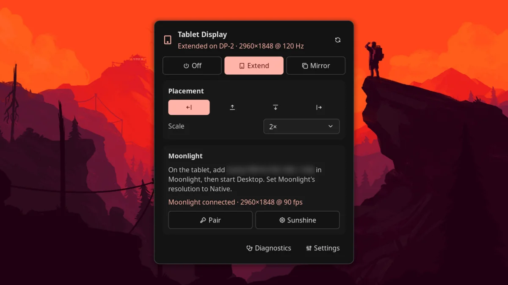

# Tablet Display

Use an Android tablet or an iPad as a second screen, **extended** or
**mirrored**, streamed by [Sunshine](https://github.com/LizardByte/Sunshine) to
[Moonlight](https://moonlight-stream.org). Game-streaming tech gives hardware
encoding, up to 120 fps and low delay, without Miracast's 1080p limit.

- **Extend** adds a display for the tablet. Move windows and workspaces onto it
  like any monitor, and place it left, right, above or below your screen.
- **Mirror** shows the monitor you're using on the tablet.
- The display matches your tablet's resolution, from a device preset or
  automatically from what Moonlight asks for.



Tested with a Samsung Galaxy Tab S9 Ultra and a Framework Laptop 16 (Radeon
780M) on niri 26.04, Hyprland 0.57, sway 1.12 and mango 0.18.5, with Sunshine
2026.1109 and Noctalia 5.4.1. iPads, other tablets and other GPUs should work
but haven't been tested; reports are welcome.

## Requirements

| What | Notes |
|---|---|
| Sunshine | From your distribution (`sudo pacman -S sunshine` on Arch/CachyOS) or [LizardByte](https://github.com/LizardByte/Sunshine/releases). |
| Moonlight on the tablet | [Play Store](https://play.google.com/store/apps/details?id=com.limelight) or [App Store](https://apps.apple.com/app/moonlight-game-streaming/id1000551566). |
| `jq`, `python3`, `pkexec` | `pkexec` (polkit) only for the port method below. |
| Same network | 5 or 6 GHz Wi-Fi, or wired for the computer. Open Sunshine's ports if you run a firewall: TCP 47984, 47989, 47990, 48010 and UDP 47998–48000. |

## How Extend adds a display

| Compositor | Method | Setup |
|---|---|---|
| Hyprland | Virtual output (`hyprctl output create headless`) | None |
| mango | Virtual output (`mmsg dispatch create_virtual_output`) | None |
| sway | Virtual output (`swaymsg create_output`) | None |
| niri | **Unused display port** — niri has no virtual outputs in a release yet | Install the port helper once |

The port method borrows an unused DP or HDMI connector: a small root helper
loads a generated EDID (the display's description) onto it and marks it
connected, so the compositor sees a real monitor. It works on AMD and Intel
graphics, not under Secure Boot kernel lockdown (`cat /sys/kernel/security/lockdown`
must show `[none]`), and not with the NVIDIA driver. Nothing is permanent: a
reboot undoes it.

The panel offers **Install helper** when it's needed. It runs
`sudo helper/install.sh`, which installs two files: the helper in
`/usr/local/libexec/noctalia-tablet-display/` and a polkit policy that lets your
logged-in session run it without a password. The helper only accepts an EDID
that passes its checksums, only touches external connectors, only turns on one
that is disconnected, and only turns off one it turned on.
`sudo helper/install.sh --remove` removes it.

## Set up Sunshine (once)

1. **Install Sunshine** (see [Requirements](#requirements)).
2. **Start it once**, so you can reach its settings page:
   ```
   systemctl --user start app-dev.lizardbyte.app.Sunshine
   ```
   The unit name depends on how Sunshine was packaged; `systemctl --user list-unit-files | grep -i sunshine`
   shows yours. Turning on **Extend** in the panel also starts it.
3. **Create Sunshine's login.** Open <https://localhost:47990>, or press
   **Sunshine** in the panel. Your browser will warn about the certificate:
   Sunshine uses a self-signed one, so continue to the page. The first visit
   asks you to choose a username and password; you need them to pair Moonlight.
4. **Leave capture settings to the plugin.** While the tablet display is on,
   the plugin sets Sunshine's output, capture method, audio and session hooks
   itself, in a marked block of `~/.config/sunshine/sunshine.conf`. Other
   settings, such as encoder and bitrate, are yours to change in the web UI.
5. **Don't enable Sunshine at login.** The plugin starts Sunshine when you turn
   the display on and stops it when you turn it off, so nothing can be
   streamed while it's off (see *Keep Sunshine running when off* in the
   advanced settings).
6. **If touch or the keyboard doesn't work later,** log out and back in once.
   Sunshine's package installs a udev rule that gives your session access to
   `/dev/uinput`, and it applies at the next login.

## Use it

1. Pick your tablet under **Settings → Plugins → Tablet Display** (or leave
   *Auto*).
2. Open the panel from the bar widget and choose **Extend** or **Mirror**.
3. **Pair, the first time:** in Moonlight on the tablet, add this computer by
   the address the panel shows. Moonlight displays a PIN. Press **Pair** in the
   panel, sign in with Sunshine's username and password, and enter the PIN.
4. In Moonlight, set the resolution to **Native** and start **Desktop**.

Right-clicking the bar widget, or the control-center tile, turns Extend on and
off.

## Good to know

- **120 Hz at full resolution** needs a lot of bandwidth (2960×1848 at 120 Hz
  is about 17 Gbit/s). If the frame rate wanders, stream at 90 fps or pick a
  lower resolution in Moonlight.
- **Sunshine is stopped before the display is removed.** If the display it
  streams disappears, Sunshine falls back to streaming another monitor, such
  as your laptop screen.
- **Touch on niri:** niri maps touch to a monitor only from its config. For
  Moonlight's direct-touch mode add `input { touch { map-to-output "DP-3" } }`
  (your display's name) to `config.kdl`. Moonlight's trackpad mode works
  without it.
- **mango** can only remove all virtual outputs at once, and re-arranges
  monitors when one changes; the plugin pins your other monitors in place.
- The plugin edits `~/.config/sunshine/sunshine.conf` only inside a marked
  block, and comments out (then restores) your own lines for the same keys.

## Command line

```
CTL=<plugin dir>/bin/tablet-display-ctl
$CTL extend | mirror [monitor] | off
$CTL set position left|right|above|below
$CTL set scale auto|1|1.5|2|...
$CTL state | jq .
$CTL doctor
$CTL uninstall      # turn off, restore sunshine.conf, delete state
```

## License

MIT. Sunshine and Moonlight are separate projects under their own licenses;
this plugin only configures and drives them.
